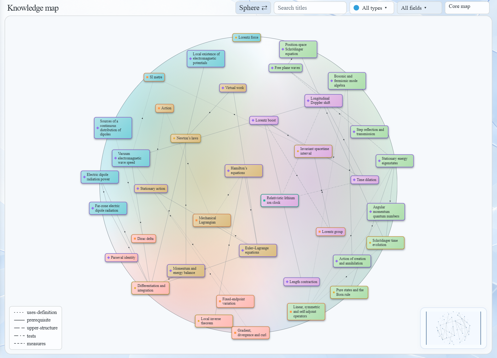

<p align="center">
  
</p>

<h1 align="center">Carnot Agent Engine (CAgE)</h1>

CAgE is a local-first workspace for working through theorems and hypotheses. I built it to give the model a particular kind of constraint: start from the facts I accept, use methods I can follow, and show how each new result follows.

## Why I made it

Most of the agents I use are built for coding. When I ask for a derivation, they have a much harder time telling what I already know. Sometimes a model introduces a theorem I've never seen and uses it to settle the very question I wanted to understand. Other times it spends a page proving something I'd happily take as a *fundamental fact*. And yes, GPT, sometimes I'd like to solve a simple problem without computing a single eigenvalue.

What I wanted was a way to say which facts we can start from, then follow the argument from there.

## What's in the project?

- **Skill map and knowledge map.** Skills and Strategies guide the model toward methods that have worked for me. The knowledge map records what a derivation can draw on, from definitions and observations to theorems and their proofs. The optional **Core map** provides a starting collection of undergraduate physics and the mathematics it uses. Each project can choose its own foundations.
- **Full derivation chain.** The model is asked to stay close to the field of the original hypothesis and build on established results. If the argument needs a new theorem, the model is asked to supply the missing derivation so I can inspect that step too.
- **Self-evolution.** After a research round, background agents can review the conversation for results worth adding to the map. Across sessions, they look for recurring preferences, methods worth turning into Skills or Strategies, and connections between existing results.

[](docs/assets/readme/core-map-sphere.png)

*The bundled Core map in spherical view. Node colors distinguish fields, and line styles identify relations such as prerequisites and uses of a definition. [Explore the map in the desktop app](docs/MAINTENANCE.md#explore-the-core-map).*

## Downloads

### Install with an agent (recommended)

Open your usual coding agent (such as ChatGPT with local tools or Claude Code) and paste this request:

```text
Please install CAgE from https://github.com/yixicu/CAgE on this computer.
Read the project's installation docs to resolve technical questions.
If a choice depends on my preferences, pause and ask me.
```

### Other ways to install

**Windows desktop.** Download the x64 installer from [Releases](https://github.com/yixicu/CAgE/releases/latest). Select the basic physics map during setup to explore the example above. Connect a provider in **Settings → Models & connections**. To check for updates, open **Settings → Plugins & general**.

**macOS.** I'd like to build a Mac desktop version once I have a Mac to test it on.

**Linux preview.** Download the `linux-system-node.tar.gz` asset from the same release and extract it. With Node.js 24.19 or later in the 24.x series and npm 11.9, run the following commands in the extracted folder. The first command downloads the production dependencies. The second starts CAgE in your system browser.

```sh
npm ci --omit=dev --ignore-scripts --no-audit --no-fund
node start.mjs
```

**Browser edition from source.** From the repository root, use the same Node.js and npm versions:

```sh
cd app
npm ci --ignore-scripts
npm run build
npm start
```

Open the local address printed by the server.

**Upgrading an existing source checkout.** Stop the old server before pulling updates. Starting from `app/` reopens the repository root's existing `.carnot-data/`, including its provider connections and storage settings. A fresh checkout uses `app/.carnot-data/`. If both directories exist, the launcher shows both paths. Enter `1` for the pre-update layout or `2` for the post-update layout. It remembers your choice for this checkout. Delete `app/.carnot-workspace-choice` to choose again, or set `CARNOT_DATA_DIR` to override the choice for one launch. Back up your workspace and any separately configured research and log directories before changing their locations.

## How to use CAgE

### General usage

Connect your provider in **Settings → Models & connections**, open **New research**, and enter a hypothesis in the chat box. For example: *Can you derive Hamilton's equations from stationary action? Show where the derivation needs an invertible relation between velocity and momentum.*

The left sidebar holds your session history and the **cages** views for Skills and Knowledge. The right-hand monitor lets you follow the current research session.

Use **Maintenance Assistant** in the sidebar to inspect a saved round, see where a call failed, or attach study notes for the assistant to turn into proposed map entries. You can review a proposal before allowing changes. [Maintenance guide](docs/MAINTENANCE.md)

To have the V4 Theorist read a paper, paste its public URL or attach the PDF. To have it *search* for papers, install **Web search** in **Settings → Plugins & general**, choose a search provider, add its API key, and enable the plugin. [Web search setup](docs/PLUGINS.md#web-search)

### What if I can't connect my provider?

So far, I've only tested the connection with my own ChatGPT subscription. If another provider gives you trouble, tell me which provider you tried and what error you saw. [Open an issue](https://github.com/yixicu/CAgE/issues)

### I found a bug

Please include what you were doing, what you expected, and what happened. [Report a bug](https://github.com/yixicu/CAgE/issues)

### I found a bug and want to fix it now

Point your coding agent to the architecture guide. It traces a request from the desktop UI to the research engine and shows which part of the repository owns each feature. [Architecture guide](docs/AGENTS.md)

### How do I build a plugin?

Start with the bundled text-statistics example. The plugin guide walks through defining a tool, granting it to a role, and checking which research stages can use it. [Plugin development guide](docs/PLUGINS.md)

### Can I keep using my existing agents?

Yes. A running Codex session can supply independent subagents for CAgE's research roles. Ask your agent to follow the setup guide and start the bundled local host, then pair it in **Settings → Models & connections → Local subagents**. I recommend giving the guide directly to your agent. It includes the instructions for driving a research run. [Subagent setup](docs/SUBAGENTS.md)

### Already reading this as an AI agent?

| Folder | What you'll find |
| --- | --- |
| [app](app/) | The shared research engine, browser interface, launch scripts, and bundled plugin manifest. |
| [desktop-packaging](desktop-packaging/) | The Windows shell, installer, updater, and [release instructions](desktop-packaging/README.md). |
| [docs](docs/README.md) | The documentation index, including the [architecture guide for agents](docs/AGENTS.md), maintenance operations, and plugin development. |

## License

[MIT license](docs/LICENSE)

## References

CAgE's backend uses the [Pi agent runtime](https://github.com/earendil-works/pi). Other projects I've looked at while developing CAgE include:

- [All Agentic Architectures](https://github.com/FareedKhan-dev/all-agentic-architectures)
- [Claude Code](https://github.com/anthropics/claude-code)
- [Codex](https://github.com/openai/codex)
- [DeepSeek Harness](https://github.com/deepseek-ai/deepseek-harness)
- [GraphRAG](https://github.com/microsoft/graphrag)
- [GTPyhop](https://github.com/dananau/GTPyhop)
- [Harness²](https://github.com/google-research/harness2)
- [Hermes Agent](https://github.com/NousResearch/hermes-agent)
- [LangGraph](https://github.com/langchain-ai/langgraph)
- [Prime Agent](https://github.com/PrimeIntellect-ai/prime-agent)
- [Soar](https://github.com/SoarGroup/Soar)
