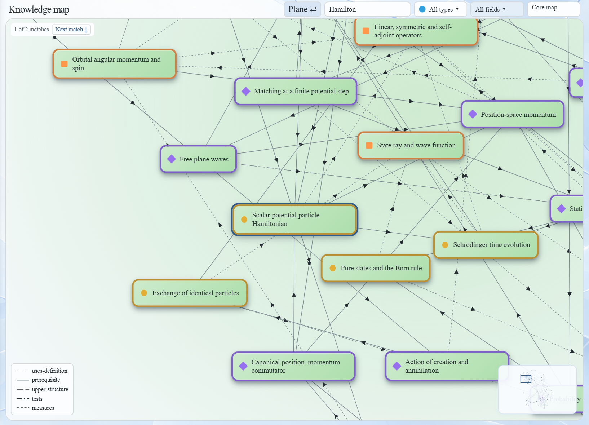

# Maintenance Assistant

Open **Maintenance Assistant** in the sidebar. Select a project for its saved rounds and V4 knowledge map, or **Shared library & Core map** for shared scientific nodes, Skills and Strategies. When installed, the Core map is imported once and is available to Theorists and their Workers. Opening a supplied argument does not accept it as a foundation. Choose a connected model. Leave **Allow changes** clear to inspect records or preview an edit. To apply a proposal, stay in the same scope, check **Allow changes**, and send a new instruction. The checkbox resets after submission and when you change scope.

## Explore the Core map

In the left sidebar, select **Knowledge** beside **cages**. With the optional basic physics map installed, the toolbar shows **Core map**. Use **Search titles** to find a node, or narrow the view by scientific field or node type. For example, search for `Hamilton` and use **Next match** to move between the particle Hamiltonian and Hamilton’s equations.



Select a node to read its statement and any recorded assumptions or proof. Use the **Plane ⇄** button to switch to the spherical view. To look for a newer revision of the bundled map, open **Settings → Plugins & general → Core map updates**.

## Diagnose a project or recover an interrupted turn

Select the project and ask “What happened in epoch 3? Show the failed call, its recorded error category and the public report, if available.” The assistant can read saved round outcomes, the project's last error, recent learning jobs, and V4 research-review and map-maintenance task statuses. A numbered epoch exposes its recorded call statuses and public reports. Ask the Theorist to solve or refute a new proposition.

The conversation displays tool progress. **Stop** interrupts the turn. An earlier write may already have completed. Before retrying, ask “Check the receipts from the interrupted turn and read the current version of the affected node.” The assistant can search earlier maintenance turns and read attached notes in the selected scope.

The assistant has no shell, general file browser, or tool for opening, editing, exporting or deleting raw logs. For a startup failure, open `launcher-logs/` under the active **System logs and records** folder yourself. To ask about a particular line, attach a short text excerpt after removing private research content, local paths and credentials as appropriate. The selected provider receives content the assistant reads during its turn.

## Import a note into a project

1. Select the destination project. Choose **+** (**Attach note**) and select one UTF-8 text file. The picker accepts Markdown, plain text, LaTeX source, CSV and JSON. The limits are 200,000 characters and 800,000 bytes per attachment. Convert a scanned or binary document to text first.
2. Ask “Compare this note with the existing map. List the missing definitions, the theorem's assumptions and the exact premises its proof uses.” For a long source, divide it into sections that include the assumptions needed for each result.
3. Review the proposal. Enable **Allow changes** and ask the assistant to apply the specified additions using the previous note. Concepts begin as drafts. A new theorem or a change to its scientific content requires the supplied proof and a review of the decisive inference. Ask for the missing step if the evidence is insufficient.
4. Verify the result with “Show the exact node version, statement, premises, proof and review.” For a title or metadata change, ask to preserve the theorem body, assumptions and proof support. Retirement preserves the node's history. Measurements, canonical theory projections and accepted foundations have separate controls. For example, a proposed foundation in a project's knowledge updates has its own acceptance button.

## Manage and transfer Skills and Strategies

Select **Shared library & Core map**. Ask for matches by title, then ask to read the chosen card's ID, version, full Markdown body, applicability and tags. A change here affects the shared library across projects.

| To do this | Ask the assistant |
|---|---|
| Create a method or failure Skill | “Turn the attached note into a Skill. Give it a searchable title, state when it applies, and put one reusable action on each bullet line.” |
| Create a specific Strategy | “Create a Strategy for choosing this route. State the condition, the preferred route and why it applies in one short paragraph.” |
| Edit a card | “Read the exact current version. Preserve the other steps and revise the second step using these conditions. Show the new version.” |
| Retire a card | “Retire this exact version and report its ID and resulting status.” |

Creation, revision and retirement require **Allow changes**. Created and revised cards start disabled with status `needs_review`. If another edit changed the target, read the new version before reapplying the change. For a manual edit of an available card, open the resource in **cages** and use **Edit resource** when enabled.

For a portable text copy, ask for the card's complete body and metadata, then save the reply as Markdown yourself. In the destination workspace, select **Shared library & Core map**, attach the file, and ask for a new card of the same kind. Verify its stored body and status. This transfers the instructions as a new revision-one card. IDs, history, provenance and review decisions belong to the source workspace. The assistant has no bulk Skill/Strategy package importer or file-export tool.

## Transfer a V4 knowledge map

For a single readable record, ask the assistant to show the node and its attached proof, then save the text yourself. For a transferable project map folder, use the local command-line helper. The assistant can explain the procedure but cannot run the helper or select a destination folder.

Keep Carnot running. In PowerShell, use the actual loopback origin of your running instance (`4327` is the default). The following commands list V4 project IDs and names and fetch the destination's current profile version. The bootstrap token stays in the PowerShell session.

```powershell
$origin = 'http://127.0.0.1:4327'
$bootstrap = Invoke-RestMethod "$origin/api/bootstrap"
$bootstrap.projects | Where-Object researchLoopVersion -eq '4.0' | Select-Object id,name
$target = 'DESTINATION_PROJECT_ID'
$headers = @{ 'X-Carnot-Token' = $bootstrap.requestToken }
$profileVersion = (Invoke-RestMethod "$origin/api/research/knowledge-map?projectId=$target" -Headers $headers).profile.version
```

From the checkout's `app/` folder, or the desktop installation's `payload/app/` folder, use Node to run the following commands. Set `$mapFolder` to a new folder in a writable location. For a transfer between workspaces, export against the source instance, move the entire folder, and repeat the lookup above against the destination instance before importing.

```powershell
$source = 'SOURCE_PROJECT_ID'
$mapFolder = 'D:\Maps\my-map'
node scripts/project-map.mjs export $origin $source $mapFolder
node scripts/project-map.mjs import $origin $target $mapFolder $profileVersion
```

On Linux, run the following in the extracted release directory. For a Debian installation, use `cd /opt/carnot-agent-engine` and replace `node` with `./node`. The first Node command lists the V4 project IDs and names. Substitute the chosen IDs, use an unused export path, and point `origin` at the destination instance before looking up its profile version for import.

```sh
origin=http://127.0.0.1:4327
node --input-type=module -e 'const b = await (await fetch(process.argv[1] + "/api/bootstrap")).json(); console.table(b.projects.filter(p => p.researchLoopVersion === "4.0").map(({id, name}) => ({id, name})))' "$origin"
source_id=SOURCE_PROJECT_ID
target_id=DESTINATION_PROJECT_ID
map_folder="$HOME/my-project-map"
node scripts/project-map.mjs export "$origin" "$source_id" "$map_folder"
profile_version=$(node --input-type=module -e '
  const [origin, id] = process.argv.slice(1);
  const {requestToken} = await (await fetch(origin + "/api/bootstrap")).json();
  const url = new URL("/api/research/knowledge-map", origin);
  url.searchParams.set("projectId", id);
  const view = await fetch(url, {headers: {"X-Carnot-Token": requestToken, Origin: origin}});
  if (!view.ok) throw Error("Map lookup failed: " + view.status);
  console.log((await view.json()).profile.version);
' "$origin" "$target_id")
node scripts/project-map.mjs import "$origin" "$target_id" "$map_folder" "$profile_version"
```

The export contains `map.json`, `statements/` and `proofs/` with checksums for the text files. Import selects the latest eligible active project-local concepts, theorems and observations, and recreates eligible links between them. Historical versions and source decisions remain in the snapshot. The destination owns the new entries and reviews their evidence and foundation choices. Check imported and skipped counts and open representative proofs. For a retry of the same batch, use the original import arguments. To propose changes to an exported statement, attach its Markdown as a note. Editing the package files in place invalidates their checksums.

If you separately have a **core map** package containing `core-map.mjs`, run the following from that package's directory, using the destination and profile version above.

```powershell
node core-map.mjs
node core-map.mjs $origin $target $profileVersion
```

The first command validates the package and reports node and link counts. Append `--accept-foundations` to the first import only if you have examined and wish to accept all its packaged foundations. For an imported proof or measurement, select the destination in Maintenance, enable **Allow changes**, and ask for review of that exact item. The assistant reads its supplied evidence and records a verdict. For a measurement, provide the source excerpt and locator, conditions, value, units and uncertainty where applicable. Check the recorded outcome before relying on it.

## Find the files on disk

Open **Settings → Research → Storage folders** to see **Knowledge and project files** and **System logs and records**. Changing a folder takes effect after exit and restart. Existing files stay in their previous location.

| Location | Contents |
|---|---|
| Active knowledge and project folder | Project records, the shared research library, `maintenance/session.json` for maintenance turns and receipts, and `maintenance/notes/` for attachments. Notes are saved even on read-only turns. The original filename and digest are recorded, and the saved text uses a hash-based filename. |
| Active system folder | Launcher logs under `launcher-logs/` and runtime records under `pi/`. |
| Workspace selected at launch | Storage-folder preferences and provider authentication data. The source launch defaults to `.carnot-data/` under the application directory. The desktop launcher uses its configured workspace. `CARNOT_DATA_DIR` selects a workspace at launch. |

Use the map package or a selected card's Markdown when sharing research. The workspace also contains private prompts, attachments, run records and provider authentication data. [Source architecture](https://github.com/yixicu/CAgE/blob/main/docs/AGENTS.md)
